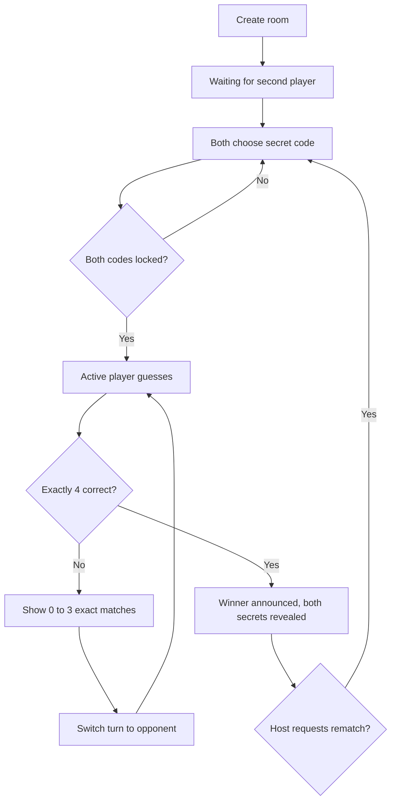

# Game Design Document — Fourcast

**Version:** 1.0 MVP  
**Platform:** Responsive mobile browser (two phones, over the internet, with a publicly hosted Node server)  
**Genre:** Turn-based social deduction / logic / guessing  
**Players:** Two in each room. Multiple independent rooms may be active.  
**Account:** None required.

## 1. Core idea

Each player knows only their own secret code and attempts to guess the other player's four-digit code. Feedback reports the **count of correctly positioned digits**, not which ones they are. Thinking logically across prior guesses is the strategy. First to hit 4/4 wins.

Example in Unique mode:

| Opponent's secret | Your guess | Exact-position score | Explanation |
| --- | --- | --- | --- |
| `1234` | `4321` | `0/4` | All digits are in the wrong place; no hint is given for them |
| `1234` | `1256` | `2/4` | Only positions 1 and 2 match |
| `1234` | `1234` | `4/4` | Match; you win immediately |

Example in Repeatable mode: secret `1122` against guess `1111` returns `2/4`.

## 2. Two modes

- **No repeats:** All four digits must be distinct in both secret codes and guesses; `0123` valid, `0012` invalid.
- **Repeatable:** Digits may repeat in both codes and guesses; `0000` and `9090` valid.
- **Both:** Leading zeros are legal; every code is exactly four **characters**, not a numeric integer. Four numbers and their positions must all match for victory.

## 3. User journeys and screens

1. **Home:** Enter nickname; create room or join room. Creator chooses mode.
2. **Waiting lobby:** See six-character room code, copy/share link, and wait for Player 2. Host may change mode.
3. **Secret selection:** Both players privately enter four digits with the touch keypad and lock their code. Ready status is shown; the digits are not revealed to the rival.
4. **Game screen:** See current turn indicator, numeric guess keypad, last guess and its exact-position count, and a chronologically ordered guess history.
5. **Result:** Display winner, both codes, total guess counts, and rematch action.
6. **Reconnect:** Browser refresh or temporary network drop restores the player's seat using a randomly generated session token.

## 4. State flow



## 5. Authoritative rules

- Server owns all game state, tokens, secrets, scores, turn order and winner.
- A player can only submit a secret during code selection, once per round.
- A player can only guess during their own turn while both players are connected.
- Bad-format or duplicate digits in Unique mode are rejected without taking a turn.
- There is no limit on the number of guesses per round.
- There is no timer in MVP, so a player may think as long as needed while connected.
- Turn alternation is strictly one submitted valid guess each.
- Host starts the first round; the other player starts the second round, alternating in later rematches.
- Win immediately ends the round, and no more guesses are accepted.

## 6. Online architecture

```text
Phone A ───┐
           │   HTTPS / WebSocket
           ├─────────────────────> Node.js HTTP + Socket.IO
           │                             │
Phone B ───┘                          GameStore
                                          │
                                      Room state
                         (tokens, secrets, turns, guesses)
```

- **Frontend:** React + TypeScript + Vite, mobile-first CSS, lucide icons.
- **Backend:** Node.js, Express and Socket.IO.
- **Storage:** Server memory in MVP. No pre-existing customer database is touched.
- **Realtime protocol:** Socket.IO client actions with success/error acknowledgements; server broadcasts filtered room snapshots.
- **Transport:** Public HTTPS URL accessible over the internet (Wi-Fi or mobile data); shared Wi-Fi is not necessary.

## 7. Socket event contract

| Client event | Payload | Requirement |
| --- | --- | --- |
| `room:create` | `{name, mode}` | Creates private code, returns own session token |
| `room:join` | `{name, code}` | Room exists, open and waiting for Player 2 |
| `room:resume` | `{code, token}` | Token must belong to room |
| `room:mode` | `{mode}` | Host only; before either secret is set |
| `room:secret` | `{code}` | Setup phase; four digits consistent with mode |
| `room:guess` | `{guess}` | Playing phase; own turn; both online |
| `room:rematch` | `{}` | Host only; previous round finished |
| `room:leave` | `{}` | Mark connection offline; retain resumable seat |

Server broadcasts `room:update` to each player with their personalized state. The response includes players, phase, mode, turns and guesses but **never secrets before the round is complete**.

## 8. Acceptance checks

- [x] Two clients can be assigned to the same room and a third is rejected by the engine.
- [x] Both modes validate secrets and guesses, including `0`-leading codes.
- [x] Position-only feedback (0–4) is calculated correctly.
- [x] The engine prevents consecutive guesses by the same player.
- [x] The engine pauses when one person is offline.
- [x] One player gets 4/4 and the engine ends the round.
- [x] Opponent secrets are not included in pre-win broadcasts.
- [x] A rematch resets guesses and rotates the starting player.
- [x] A returning player's token restores the original seat.
- [ ] Browser-to-browser integration test (requires installing npm dependencies).
- [ ] Live test from two separate phones.
- [ ] Publicly hosted deployment with a fresh repository.

## 9. Practical next steps

Push the source to `HY0831/fourcast-number-duel`, run CI, and deploy as a single Node web service using `render.yaml`. Before a large audience, add Redis/Postgres-backed storage and authentication/rate limiting proportionate to the app's usage.
